# Chương: Phân tích dữ liệu và mô hình dự báo AQI

## Bức tranh tổng thể

Phần này nằm ở cuối pipeline của hệ thống. Vai B thu thập dữ liệu thô, vai C dùng Spark để làm sạch và tổng hợp, sau đó vai D mới thực hiện phân tích và huấn luyện mô hình:

```text
OpenAQ / AQICN / Open-Meteo
            │
            ▼
     B: dữ liệu thô
      (Kafka, MinIO)
            │
            ▼
    C: Spark xử lý
  làm sạch, tính AQI,
  ghép thời tiết, tổng hợp
            │
            ▼
 daily_agg + weather_hourly
            │
            ▼
 D: phân tích và dự báo +24h
            │
            ▼
       forecasts
            │
            ▼
       A: Grafana
```

Như vậy, phần D **không đọc trực tiếp dữ liệu thô** và không tự phát cảnh báo từ số đo hiện tại. D nhận dữ liệu thành phố–giờ đã được C chuẩn hóa, tìm các quy luật trong dữ liệu, huấn luyện mô hình dự báo AQI sau 24 giờ và ghi kết quả vào bảng `forecasts`. Cảnh báo hiện tại trong bảng `alerts` vẫn do C sinh từ AQI đo thực tế.

Chương trả lời bốn câu hỏi:

1. Dữ liệu nào đủ tin cậy để phân tích và huấn luyện?
2. AQI tại Hà Nội và TP.HCM thay đổi thế nào theo giờ và theo mùa?
3. Gió, mưa và các yếu tố thời tiết liên hệ với AQI ra sao?
4. Có thể dự báo AQI trước 24 giờ chính xác đến mức nào?

Toàn bộ số liệu và hình được sinh lại bằng `bash ml/run_all.sh`. Hình nằm trong `ml/outputs/figures/`, bảng nằm trong `ml/outputs/tables/`.

## 1. Dữ liệu đầu vào

### 1.1. Nguồn và quy mô

Phân tích dùng **dữ liệu đã xử lý**, không đọc file OpenAQ/Open-Meteo thô. Dữ liệu đầu vào có hai dạng với cùng nội dung:

- **Bảng phẳng thành phố-giờ** do job `export_ml_dataset.py` xuất ra. Bảng này dùng cho phân tích và huấn luyện mô hình.
- **Các bảng Cassandra** `daily_agg` (theo giờ) và `weather_hourly`. Các bảng này dùng cho dự báo hằng giờ.

Mỗi dòng ứng với một thành phố trong một giờ. Ví dụ, một dòng có thể mang ý nghĩa: "Hà Nội lúc 08:00 có AQI đo trung bình 120 từ 6 trạm; CAMS ước tính AQI 135; nhiệt độ 20°C, gió 2 m/s và không mưa". Các cột chia thành ba nhóm:

- **AQI đo:** trung bình các trạm quan trắc có số liệu trong giờ đó, kèm số trạm.
- **AQI mô hình:** số liệu mô hình hóa CAMS lấy qua Open-Meteo, không phải số đo.
- **Thời tiết:** nhiệt độ, độ ẩm, gió, mưa, áp suất.

| Nhóm | Số tỉnh/thành | Số dòng thành phố-giờ | Số giờ có AQI đo tại trạm |
|---|---:|---:|---:|
| Hà Nội + TP.HCM | 2 | 100.857 | 66.480 |
| 61 tỉnh/thành còn lại | 61 | 2.673.264 | 0 |
| **Tổng** | **63** | **2.774.121** | **66.480** |

Chỉ Hà Nội và TP.HCM có trạm đo trong bộ dữ liệu. Vì vậy:

- Phân tích AQI thực tế và mô hình dự báo chỉ thực hiện cho Hà Nội và TP.HCM.
- 61 tỉnh/thành còn lại chỉ có CAMS và thời tiết, được dùng để so sánh tương đối trên phạm vi toàn quốc ở mục 4.
- Không được coi CAMS của 61 tỉnh/thành là số quan trắc thực tế.

### 1.2. Chuỗi AQI đo bị nhảy bậc khi tập trạm thay đổi

AQI đo của một thành phố là trung bình các trạm có số liệu trong giờ. Vì vậy, giá trị này không chỉ phụ thuộc vào chất lượng không khí mà còn phụ thuộc vào việc *trạm nào* đang hoạt động.

Ví dụ, nếu trước đây thành phố chỉ có một trạm thường đo cao, còn từ năm sau có thêm nhiều trạm thường đo thấp hơn, AQI trung bình thành phố sẽ giảm ngay cả khi chất lượng không khí thực tế không thay đổi. Trong giai đoạn 2021–2026, tập trạm của cả hai thành phố đã thay đổi rõ rệt:

| Thành phố | Năm | % giờ có AQI đo | Số trạm trung bình | AQI đo TB | AQI mô hình TB | Đo − mô hình |
|---|---|---:|---:|---:|---:|---:|
| Hà Nội | 2022 | 35,2 | 1,0 | 123,0 | 110,8 | +12,1 |
| | 2023 | 64,5 | 1,0 | 109,6 | 117,8 | −8,2 |
| | 2024 | 95,6 | 11,5 | 94,6 | 113,0 | −18,3 |
| | 2025 | 97,8 | 5,6 | 98,1 | 131,1 | −33,0 |
| TP.HCM | 2022 | 42,3 | 1,0 | 79,2 | 86,4 | −7,2 |
| | 2023 | 31,4 | 1,0 | 92,0 | 79,6 | +12,4 |
| | 2025 | 85,1 | 1,2 | 96,4 | 95,1 | +1,3 |

Mô hình CAMS dùng cùng một phương pháp cho mọi năm, nên có thể làm thước đo ổn định để so sánh. Ở Hà Nội, khoảng cách "đo − mô hình" dao động quanh 0 trong 2022–2023, rồi đổi hẳn sang −18 đến −33 từ năm 2024. Không khí không đột ngột sạch hơn so với mô hình; nguyên nhân là nguồn số liệu đã đổi:

- **Hà Nội:** 2021–2023 chỉ có trạm của Đại sứ quán Mỹ. Từ 2024 có thêm mạng trạm của thành phố, gồm 4–12 trạm, và các trạm này đo thấp hơn có hệ thống.
- **TP.HCM:** 2021–2023 là trạm của Lãnh sự quán Mỹ. Trạm này ngừng cho số liệu hợp lệ từ 2024. Từ 19/11/2024 chỉ còn một cảm biến giá rẻ (trạm CMT8).

Dữ liệu real-time đến từ cùng loại trạm với giai đoạn sau. Vì vậy, **phân tích chính và mô hình chỉ dùng giai đoạn mạng trạm hiện tại**: Hà Nội từ 01/2024, TP.HCM từ 19/11/2024. Đây là quyết định quan trọng nhất của chương.

Nếu trộn cả hai giai đoạn, mô hình có thể học một quan hệ giả như "sang năm 2024 thì AQI giảm", trong khi nguyên nhân thật là hệ thống đã đổi trạm và thiết bị đo. Khi đó kết quả kiểm thử có thể đẹp nhưng không đại diện cho dữ liệu real-time mà hệ thống đang nhận.

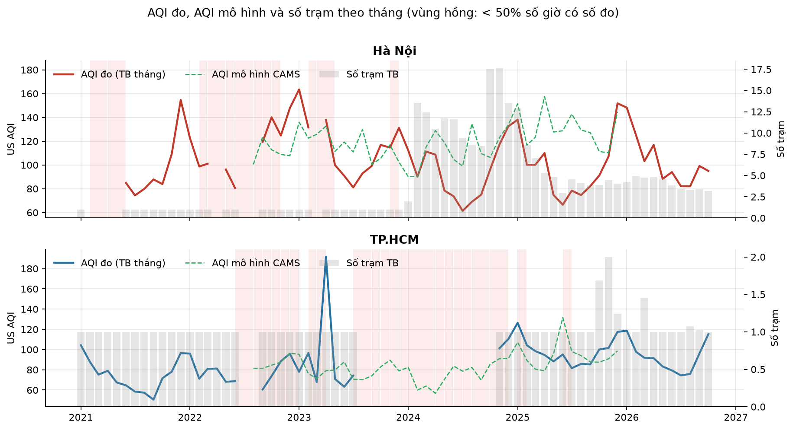

### 1.3. Độ đầy đủ trong giai đoạn sử dụng

| Thành phố | Giai đoạn | Số giờ | % giờ có AQI đo | Số khoảng trống | Khoảng trống dài nhất | Số trạm (trung vị) |
|---|---|---:|---:|---:|---:|---:|
| Hà Nội | 01/2024 – 07/10/2026 | 24.163 | 97,6 | 37 | 76 giờ | 5 |
| TP.HCM | 19/11/2024 – 07/10/2026 | 16.382 | 91,9 | 51 | 690 giờ (~29 ngày) | 1 |

Hà Nội có dữ liệu gần như liên tục. TP.HCM phụ thuộc vào một cảm biến duy nhất, nên khi cảm biến dừng thì thành phố không có số liệu; khoảng trống dài nhất gần một tháng. Đây là một trong những nguyên nhân khiến mô hình TP.HCM kém ổn định hơn mô hình Hà Nội.

Thời tiết lịch sử chỉ có đến 31/12/2025, nên các phân tích có dùng thời tiết và mô hình dự báo chỉ dùng đến hết năm 2025. Dữ liệu AQI năm 2026 vẫn có thể dùng cho phân tích không cần thời tiết, nhưng chưa được đưa vào huấn luyện mô hình hiện tại.

### 1.4. Phân biệt số đo thật và số mô hình

Hai loại dữ liệu này trả lời hai câu hỏi khác nhau:

| Loại | Cột nhận biết | Ý nghĩa | Cách dùng trong phần D |
|---|---|---|---|
| Số đo | `is_model = false`, `data_basis = measured` | Quan trắc tại trạm OpenAQ/AQICN | Là chuỗi thực tế và mục tiêu cần dự báo |
| Số mô hình | `is_model = true`, `data_basis = model` | CAMS ước tính chất lượng không khí trên ô lưới | Đối chiếu và so sánh tương đối giữa các vùng |

`is_model` không cho biết AQI có sẵn hay do C tự tính. OpenAQ là số đo thật nhưng C phải tính AQI từ PM2.5/PM10; AQICN là số đo thật và có AQI sẵn; CAMS là số mô hình và cũng có `us_aqi` sẵn.

Trên cùng các giờ, AQI mô hình CAMS khớp với AQI đo ở mức thấp:

| Thành phố | Số giờ | Tương quan theo giờ | Tương quan theo ngày | AQI đo TB | AQI mô hình TB | Sai lệch tuyệt đối TB |
|---|---:|---:|---:|---:|---:|---:|
| Hà Nội | 16.981 | 0,49 | 0,56 | 96,4 | 121,3 | 36,0 |
| TP.HCM | 8.477 | 0,23 | 0,36 | 97,8 | 92,3 | 26,6 |

Ở Hà Nội, CAMS cho AQI cao hơn số đo khoảng 25 đơn vị. Mức tương quan theo giờ chỉ 0,49 tại Hà Nội và 0,23 tại TP.HCM, nên CAMS **không được dùng để lấp chỗ trống** của chuỗi đo. Nếu lấp như vậy, mô hình ML sẽ được huấn luyện trên một chuỗi trộn giữa quan trắc và ước tính. Trong chương này, CAMS chỉ được dùng để đối chiếu và so sánh tương đối giữa các tỉnh.

## 2. Đặc điểm AQI của Hà Nội và TP.HCM

### 2.1. Tổng quan

Các thống kê dưới đây dùng giai đoạn mạng trạm hiện tại đã chọn ở mục 1.2. "Phân vị 95%" là mức mà 95% số giờ nằm dưới nó; 5% số giờ còn lại có AQI cao hơn mức này. Chỉ số này cho biết mức ô nhiễm cao nhưng vẫn xuất hiện tương đối thường xuyên, ít bị chi phối bởi một vài giá trị cực đoan hơn giá trị lớn nhất.

| | Hà Nội | TP.HCM |
|---|---:|---:|
| Số giờ có số đo | 23.585 | 15.052 |
| AQI trung bình / trung vị | 98,5 / 90,8 | 94,4 / 89,0 |
| AQI phân vị 95% | 172,2 | 155,0 |
| % giờ AQI > 150 | 11,5 | 7,4 |
| % ngày có AQI trung bình ngày > 150 | 8,8 | 1,2 |

Phân bố theo hạng AQI (% số giờ):

| | Tốt (0–50) | Trung bình | Kém cho nhóm nhạy cảm | Xấu | Rất xấu | Nguy hại |
|---|---:|---:|---:|---:|---:|---:|
| Hà Nội | 6,2 | 53,2 | 29,0 | 10,3 | 1,3 | 0,0 |
| TP.HCM | 1,8 | 64,5 | 26,3 | 7,2 | 0,1 | 0,0 |

Ở cả hai thành phố, chưa tới 7% số giờ có không khí ở mức "Tốt", và khoảng 35–40% số giờ ở mức "Kém cho nhóm nhạy cảm" trở lên. Nói cách khác, chất lượng không khí không chỉ xấu trong một vài đợt hiếm gặp; các mức có ảnh hưởng đến sức khỏe xuất hiện với tỷ lệ đáng kể.

**Cần thận trọng khi so sánh mức AQI giữa hai thành phố.** Trên 14.915 giờ cả hai cùng có số đo, AQI trung bình của Hà Nội là 102,2 và của TP.HCM là 94,4; Hà Nội ô nhiễm hơn trong 57% số giờ. Khoảng cách này nhỏ hơn nhiều so với giai đoạn 2021–2023, khi cả hai thành phố đều đo bằng thiết bị của cơ quan ngoại giao Mỹ (TP.HCM sạch hơn rõ rệt). Nguyên nhân có thể nằm ở thiết bị: TP.HCM hiện chỉ có một cảm biến giá rẻ, loại thường đo cao khi độ ẩm cao. Vì vậy, so sánh *chu kỳ và xu hướng* giữa hai thành phố đáng tin cậy hơn so sánh *mức tuyệt đối*.

### 2.2. Chu kỳ trong ngày

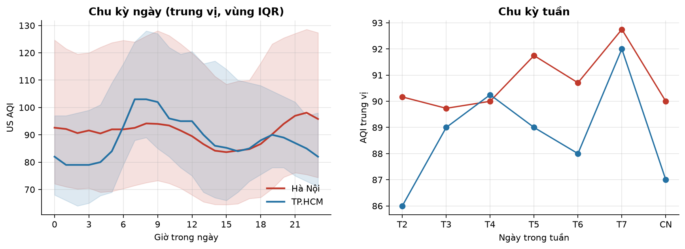

- **Hà Nội:** AQI thấp nhất vào đầu giờ chiều (trung vị 84 lúc 15 giờ) và cao nhất vào buổi tối (98 lúc 22 giờ). Ban ngày, lớp không khí sát mặt đất được đốt nóng và xáo trộn mạnh nên bụi phân tán; về đêm, lớp này mỏng lại, cộng thêm khí thải giao thông giờ tan tầm và đun nấu, nên bụi tích tụ.
- **TP.HCM:** AQI cao nhất vào giờ cao điểm buổi sáng (103 lúc 7–9 giờ) và thấp nhất lúc rạng sáng (79 lúc 1–3 giờ). Chu kỳ này bám sát nhịp giao thông.

Đây là mô tả thống kê chứ chưa phải bằng chứng nhân quả. Ví dụ, đường AQI tăng vào giờ cao điểm phù hợp với giả thuyết về giao thông, nhưng dữ liệu hiện tại chưa tách được giao thông khỏi các yếu tố đồng thời như độ cao lớp biên khí quyển hay hướng gió.

### 2.3. Chu kỳ theo mùa

| Thành phố | Mùa | AQI trung bình | AQI trung vị |
|---|---|---:|---:|
| Hà Nội | Xuân (2–4) | 107,3 | 103,5 |
| | Hạ (5–7) | 77,6 | 73,7 |
| | Thu (8–10) | 84,5 | 78,8 |
| | **Đông (11–1)** | **129,9** | **130,5** |
| TP.HCM | **Mùa khô (11–4)** | **103,4** | **96,0** |
| | Mùa mưa (5–10) | 85,6 | 81,0 |

Mùa có tác động mạnh nhất đến AQI của Hà Nội: AQI mùa đông cao gấp khoảng 1,7 lần mùa hè. Ngày có AQI trung bình ngày vượt 150 tập trung vào tháng 12 (45% số ngày) và tháng 1 (30%); từ tháng 5 đến tháng 8 không có ngày nào. Ở TP.HCM, mùa khô cao hơn mùa mưa khoảng 20%, và ngày vượt ngưỡng 150 hiếm, cao nhất là tháng 1 với 7% số ngày.

**Kết luận mục 2:** chu kỳ của Hà Nội chịu ảnh hưởng mùa rất mạnh, còn TP.HCM thể hiện rõ nhịp giao thông trong ngày và sự khác biệt giữa mùa khô với mùa mưa. Những chu kỳ này là lý do mô hình cần các đặc trưng `hour`, `month` và `dayofyear`.

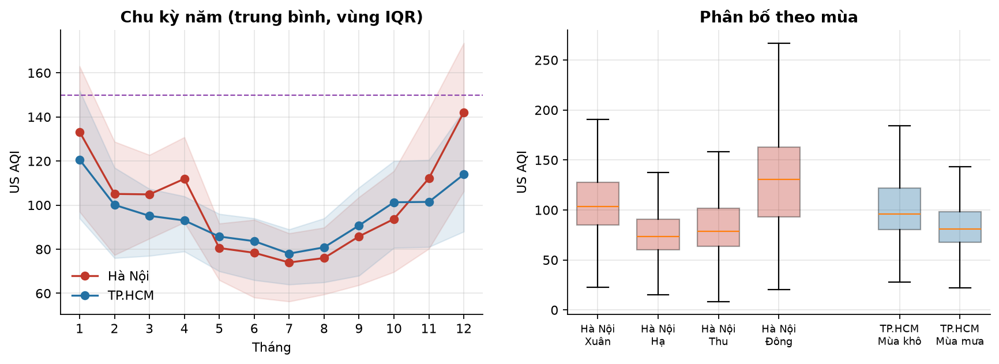

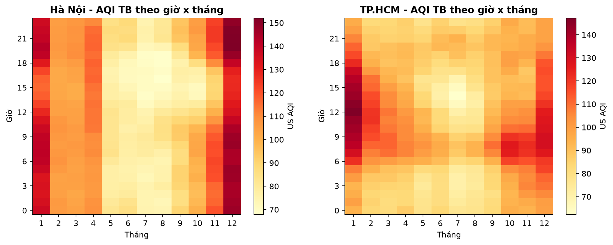

## 3. Ảnh hưởng của thời tiết

### 3.1. Hệ số tương quan

Dùng hệ số Spearman, vì hệ số này đo quan hệ đơn điệu, không cần giả định tuyến tính và ít bị ảnh hưởng bởi giá trị ngoại lai. Có thể đọc hệ số này như sau:

- Gần `+1`: yếu tố tăng thì AQI thường tăng.
- Gần `−1`: yếu tố tăng thì AQI thường giảm.
- Gần `0`: chưa thấy quan hệ đơn điệu rõ.

Ví dụ, hệ số `−0,46` giữa gió và AQI không có nghĩa "gió tăng 1 m/s thì AQI giảm 0,46 điểm". Nó chỉ cho biết những ngày gió mạnh thường xếp thấp hơn về AQI. Tương quan cũng không tự chứng minh quan hệ nhân quả.

Thời tiết lấy từ Open-Meteo, ghép cùng thành phố và cùng giờ với AQI. Số liệu trong giai đoạn 2024–2025.

| Yếu tố | Hà Nội (theo ngày) | Hà Nội (trong cùng tháng) | TP.HCM (theo ngày) | TP.HCM (trong cùng tháng) |
|---|---:|---:|---:|---:|
| Tốc độ gió | −0,29 | **−0,46** | −0,51 | **−0,39** |
| Lượng mưa | −0,56 | **−0,35** | −0,25 | 0,00 |
| Áp suất | +0,44 | −0,08 | +0,32 | −0,01 |
| Nhiệt độ | −0,39 | +0,21 | −0,10 | −0,01 |
| Độ ẩm | −0,36 | −0,13 | −0,17 | −0,01 |

Cột "trong cùng tháng" là kết quả tính tương quan riêng trong từng tháng rồi lấy trung bình. Cách tính này nhằm giảm ảnh hưởng của mùa.

Ví dụ, nếu tính chung cả năm, mùa đông Hà Nội đồng thời lạnh, áp suất cao và ô nhiễm. Ta có thể thấy nhiệt độ tương quan âm với AQI rồi vội kết luận "nhiệt độ thấp gây ô nhiễm". Khi chỉ so sánh các ngày trong cùng một tháng, điều kiện mùa tương đối giống nhau; quan hệ còn lại phản ánh tốt hơn biến động thời tiết ngắn hạn. Từ bảng có thể rút ra:

- **Gió là yếu tố có tác động rõ nhất ở cả hai thành phố.** Ngay trong cùng một tháng, ngày gió mạnh có AQI thấp hơn rõ rệt (ρ = −0,46 ở Hà Nội, −0,39 ở TP.HCM), vì gió làm bụi phát tán.
- **Mưa làm giảm mạnh AQI ở Hà Nội** (ρ = −0,35 trong cùng tháng). AQI trung vị của ngày mưa (≥ 1 mm) là 74,8, so với 108,4 của ngày không mưa, tức thấp hơn 31%. Ở TP.HCM, ngày mưa cũng có AQI thấp hơn (90,2 so với 102,3), nhưng hiệu ứng này biến mất khi xét trong cùng tháng. Như vậy ở TP.HCM, mưa chủ yếu đánh dấu mùa mưa (mùa sạch hơn), chứ từng trận mưa không làm sạch không khí rõ rệt.
- **Áp suất và nhiệt độ** tương quan khá mạnh khi tính chung cả năm, nhưng gần như mất tương quan khi xét trong cùng tháng. Tương quan chung chủ yếu do mùa.

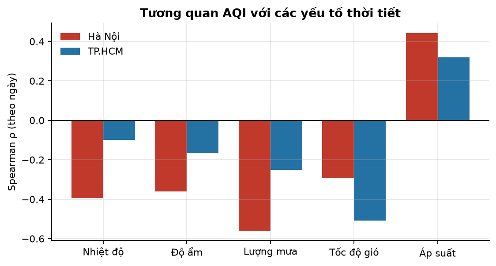

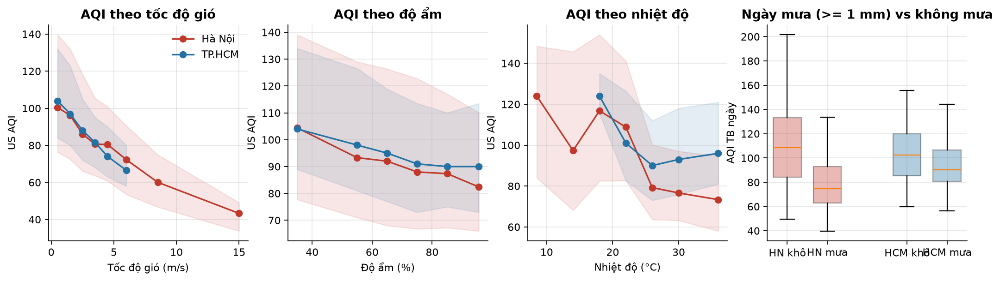

### 3.2. Hướng gió

- **TP.HCM:** khi gió thổi từ hướng Bắc – Tây Bắc (thường gặp trong mùa khô), AQI trung bình là 108–118. Khi gió thổi từ hướng Đông Nam và Tây Nam (gió mùa mùa mưa), AQI trung bình là 86–89.
- **Hà Nội:** AQI ít khác biệt theo hướng gió, chỉ dao động 93–102 giữa các hướng. Gió Đông Nam phổ biến nhất (18% số giờ). Với Hà Nội, tốc độ gió quan trọng hơn hướng gió.

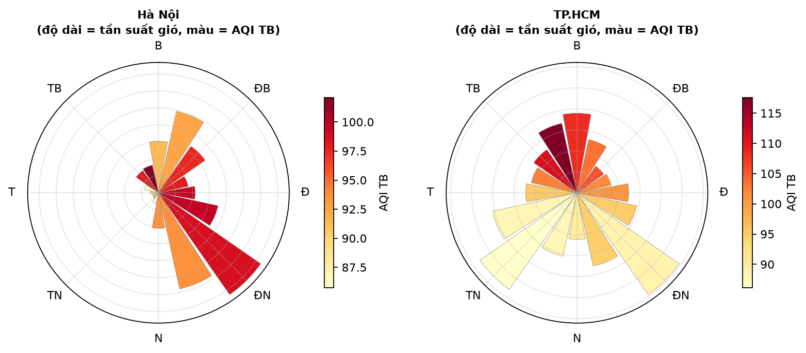

### 3.3. Ý nghĩa cho mô hình dự báo

Gió và mưa có liên hệ mạnh với AQI, đồng thời có thể thay đổi nhiều trong vòng 24 giờ. Nếu hiện tại trời lặng nhưng ngày mai có gió mạnh hoặc mưa, dự báo chỉ dựa trên thời tiết hiện tại dễ đánh giá AQI ngày mai quá cao. Vì vậy mô hình cần thêm dự báo thời tiết của ngày mai. Mục 5 kiểm chứng nhận định này bằng cách so sánh hai bộ đặc trưng có và không có thời tiết tương lai.

## 4. Hà Nội và TP.HCM trong bối cảnh 63 tỉnh/thành

Mục này dùng PM2.5 mô hình CAMS (2023–2025) cho cả 63 tỉnh/thành. Đây là giá trị mô hình, không phải số đo, nên kết quả chỉ trả lời câu hỏi "vùng nào có xu hướng cao hơn trong cùng hệ thống CAMS", không khẳng định chính xác nồng độ thực tế tại từng tỉnh.

Lưới tính của CAMS thô, khoảng 0,4° hay xấp xỉ 40 km. Một số tỉnh liền kề nằm chung một ô lưới và có chuỗi số liệu giống hệt nhau. Ví dụ Hà Nội, Bắc Giang và Bắc Ninh trùng nhau; Việt Trì và Vĩnh Yên trùng nhau. Vì vậy 63 tỉnh/thành thực chất chỉ có **53 chuỗi số liệu khác nhau**.

- **Hà Nội** đứng thứ 4/63 về PM2.5 trung bình (45,0 µg/m³, gấp khoảng 2 lần trung vị cả nước là 21,8). Ba vị trí dẫn đầu cũng thuộc vùng đồng bằng sông Hồng và trung du phía Bắc: Việt Trì và Vĩnh Yên (49,5), Hưng Yên (47,6).
- **TP.HCM** đứng thứ 22/63 (26,1 µg/m³), cao hơn trung vị cả nước một chút.
- **Theo miền:** miền Bắc có PM2.5 trung bình 33,2 µg/m³, miền Nam 19,8, miền Trung – Tây Nguyên 15,7.
- **Mùa ô nhiễm lệch nhau giữa các miền:**
  - Miền Bắc cao vào tháng 12 – tháng 4, với đỉnh tháng 4 là 45,4 µg/m³.
  - Miền Nam cao vào tháng 1 và tháng 5–6.
  - Miền Trung – Tây Nguyên chỉ có một đỉnh nhỏ vào tháng 3–4, rồi thấp trong mùa mưa thu – đông.
- **Ô nhiễm mang tính vùng:** tương quan PM2.5 theo ngày giữa hai tỉnh cách nhau dưới 100 km là 0,84, ở khoảng cách 200–300 km giảm còn 0,50, và từ 400 km trở lên còn khoảng 0,25. Bụi mịn lan rộng trên cả một vùng, không chỉ là vấn đề của riêng một thành phố.

Kết quả cuối cùng gợi ý một hướng cải thiện ML: ngoài thời tiết tại thành phố, có thể dùng CAMS của các tỉnh ở phía đầu gió làm đặc trưng báo trước sự dịch chuyển của một đợt ô nhiễm.

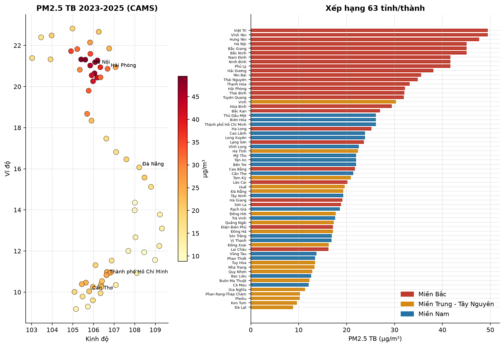

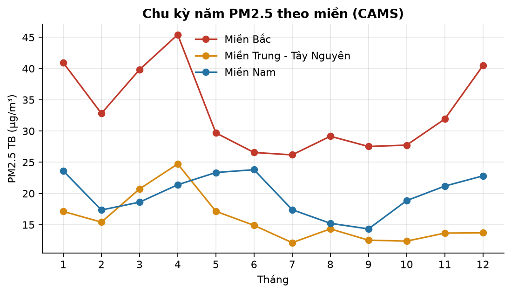

## 5. Mô hình dự báo AQI 24 giờ tới

### 5.1. Bài toán và cách đánh giá

- **Mục tiêu:** tại mỗi giờ `t`, dự báo AQI đo của thành phố tại `t + 24 giờ`. Hai thành phố có đặc điểm và hệ thống cảm biến khác nhau, nên mỗi thành phố được huấn luyện một mô hình riêng.

Ví dụ, tại 08:00 ngày 10/12, mô hình dùng AQI và thời tiết đến thời điểm đó, cộng dự báo thời tiết sắp tới, để dự báo AQI lúc 08:00 ngày 11/12.

#### Mô hình cơ sở: persistence

Mô hình cơ sở dự báo:

```text
AQI sau 24 giờ = AQI hiện tại
```

Nếu AQI hiện tại là 120, persistence dự báo AQI cùng giờ ngày mai vẫn là 120. Đây là đối thủ mạnh hơn vẻ bề ngoài vì AQI có tính liên tục: một đợt ô nhiễm thường kéo dài nhiều giờ hoặc nhiều ngày. XGBoost chỉ thực sự có giá trị nếu tốt hơn cách dự báo đơn giản này.

#### Các chỉ số đánh giá

| Chỉ số | Câu hỏi mà chỉ số trả lời | Cách đọc |
|---|---|---|
| MAE | Trung bình mô hình sai bao nhiêu điểm AQI? | Càng thấp càng tốt |
| RMSE | Mô hình có những lần sai rất lớn hay không? | Phạt lỗi lớn mạnh hơn MAE; càng thấp càng tốt |
| R² | Mô hình giải thích được bao nhiêu biến động của AQI? | `1` là lý tưởng, `0` tương đương đoán giá trị trung bình, âm là kém hơn đoán trung bình |
| Bias | Mô hình có xu hướng dự báo cao hay thấp? | Âm là dự báo thấp, dương là dự báo cao |
| Precision | Trong các lần dự báo AQI > 150, bao nhiêu lần thực sự vượt 150? | Cao nghĩa là ít báo động giả |
| Recall | Trong các giờ thực tế AQI > 150, mô hình phát hiện được bao nhiêu? | Cao nghĩa là ít bỏ lỡ ô nhiễm nặng |

Precision và recall ở đây chỉ dùng để đánh giá khả năng **cảnh báo sớm** của dự báo. Mô hình D không ghi các kết quả này vào bảng `alerts`; cảnh báo hiện tại vẫn do C sinh từ số đo thực tế.

#### Chia dữ liệu theo thời gian

Dữ liệu không được xáo trộn ngẫu nhiên. Nếu một giờ ở tháng 12 lọt vào tập train và một giờ tháng 11 nằm trong tập test, mô hình có thể gián tiếp học từ tương lai. Thay vào đó, dữ liệu được chia theo trình tự thời gian:
- **Chia dữ liệu theo thời gian, không xáo trộn ngẫu nhiên:**

| | Train | Validation (dừng sớm) | Test |
|---|---|---|---|
| Hà Nội | 01/2024 – 09/2025, trừ phần validation | 01–03/2025 | 10–12/2025 |
| TP.HCM | 19/11/2024 – 09/2025, trừ phần validation | 01–03/2025 | 10–12/2025 |

Vai trò của ba tập:

- **Train:** mô hình học các quy luật.
- **Validation:** chọn số vòng lặp và dừng huấn luyện trước khi mô hình học quá mức.
- **Test:** đánh giá cuối cùng trên giai đoạn mô hình chưa được nhìn thấy.

Tập test là giai đoạn cuối, sau mọi dữ liệu dùng để huấn luyện, nên kết quả trên test phản ánh gần hơn tình huống triển khai thật. Validation được đặt vào mùa ô nhiễm 01–03/2025. Phương án ban đầu đặt validation vào mùa hè 07–09/2025; khi đó mô hình được chọn phù hợp với AQI thấp nhưng **thua persistence** trên tập test mùa đông. Để tránh rò rỉ thông tin qua các đặc trưng trễ, 48 giờ ngay sau cửa sổ validation bị loại khỏi tập train.

### 5.2. Đặc trưng và mô hình

Mỗi dòng huấn luyện đại diện cho một lần đưa ra dự báo tại giờ `t`. Đầu ra cần học là AQI đo tại `t + 24 giờ`. Đầu vào gồm:

- **Lịch sử AQI:** AQI tại các thời điểm 0, 1, 3, 6 và 24 giờ trước, trung bình 6 giờ và 24 giờ, giá trị lớn nhất trong 24 giờ, mức thay đổi so với 24 giờ trước, số trạm đang có số đo.
- **Thời gian:** giờ, ngày trong tuần, tháng, ngày trong năm (của thời điểm cần dự báo).
- **Thời tiết hiện tại:** nhiệt độ, độ ẩm, mưa, áp suất, gió (tách thành hai thành phần Đông–Tây và Bắc–Nam), tổng mưa 24 giờ, gió trung bình 24 giờ, mức thay đổi áp suất trong 24 giờ.
- **Thời tiết của ngày mai** (chỉ có trong bộ `weather_forecast`): cùng các biến thời tiết tại t + 24 và tổng mưa trong 24 giờ tới.

Mô hình sử dụng XGBoost, một phương pháp kết hợp nhiều cây quyết định. Mỗi cây sửa một phần sai số của các cây trước, nhờ đó mô hình học được các quan hệ phi tuyến như "gió chỉ làm AQI giảm rõ khi không có áp suất cao" mà không cần viết công thức thủ công.

Thay vì dự báo trực tiếp mức AQI, mô hình học **mức thay đổi của AQI sau 24 giờ**:

```text
ΔAQI dự báo = AQI(t + 24h) − AQI(t)
AQI dự báo  = AQI hiện tại + ΔAQI dự báo
```

Ví dụ, AQI hiện tại là 120 và XGBoost dự báo mức thay đổi là −15 thì AQI ngày mai là 105. Cách này buộc mô hình tập trung trả lời "ngày mai tăng hay giảm bao nhiêu". Khi dự báo trực tiếp mức AQI, mô hình có xu hướng kéo kết quả về giá trị trung bình của tập train. Trong thử nghiệm chọn phương án, học mức thay đổi giảm MAE validation của Hà Nội từ 25,9 xuống 23,2.

Hai bộ đặc trưng được so sánh:

- **`base`:** không dùng thời tiết ngày mai. Mọi đầu vào đều có sẵn trong Cassandra.
- **`weather_forecast`:** có thêm thời tiết ngày mai. Đây là **bản triển khai**.

Việc so sánh hai bộ này kiểm tra trực tiếp giả thuyết ở mục 3: nếu gió và mưa ngày mai quan trọng, `weather_forecast` phải tốt hơn `base`. Một bộ đặc trưng dùng thêm AQI mô hình CAMS cũng đã được thử nhưng không cải thiện kết quả, nên bị loại để tránh tăng độ phức tạp không cần thiết.

### 5.3. Kết quả trên tập test (10–12/2025)

Bảng dưới đây chỉ sử dụng các giờ mà cả giá trị thực tế và persistence đều tồn tại, bảo đảm mọi mô hình được chấm trên cùng một tập dữ liệu.

| Thành phố | Mô hình | MAE | RMSE | R² | Bias | Precision (AQI > 150) | Recall (AQI > 150) |
|---|---|---:|---:|---:|---:|---:|---:|
| Hà Nội | Persistence | 28,2 | 38,7 | 0,40 | −1,3 | 0,67 | 0,66 |
| | XGBoost `base` | 27,1 | 35,6 | 0,50 | −7,6 | 0,76 | 0,28 |
| | **XGBoost `weather_forecast`** | **25,3** | **33,0** | **0,57** | −6,8 | **0,84** | 0,38 |
| TP.HCM | Persistence | 28,9 | 38,3 | −0,43 | −0,3 | 0,22 | 0,21 |
| | XGBoost `base` | 23,5 | 30,3 | 0,10 | −3,5 | 0,07 | 0,00 |
| | **XGBoost `weather_forecast`** | **22,9** | **29,3** | **0,16** | −2,9 | 0,15 | 0,01 |

Tập test của Hà Nội có 2.174 giờ, trong đó 572 giờ có AQI > 150. TP.HCM có 2.139 giờ, trong đó 262 giờ vượt ngưỡng.

MAE theo mùa trong tập test (bộ `weather_forecast`):

| Thành phố | Mùa | MAE XGBoost | MAE persistence |
|---|---|---:|---:|
| Hà Nội | Thu (tháng 10) | 19,0 | 22,9 |
| | Đông (tháng 11–12) | 28,6 | 31,0 |
| TP.HCM | Mùa mưa (tháng 10) | 21,9 | 29,5 |
| | Mùa khô (tháng 11–12) | 23,4 | 28,6 |

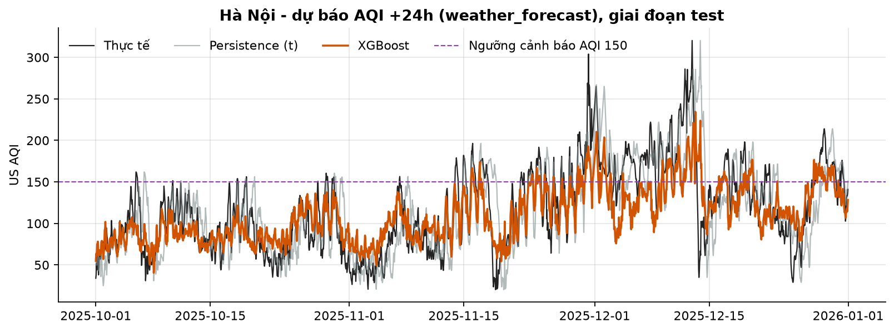

**Nhận xét:**

1. **Mô hình thắng persistence ở cả hai thành phố.** MAE giảm từ 28,2 xuống 25,3 tại Hà Nội, tương đương khoảng 10%; tại TP.HCM giảm từ 28,9 xuống 22,9, tương đương khoảng 21%. Như vậy XGBoost có học được thông tin ngoài AQI hiện tại.
2. **Thời tiết ngày mai có giá trị.** Tại Hà Nội, thêm thời tiết ngày mai giảm MAE từ 27,1 xuống 25,3. Sau AQI hiện tại (16% tổng mức đóng góp), các đặc trưng quan trọng nhất là tổng mưa 24 giờ tới (8,5%), tháng (6,4%) và tốc độ gió ngày mai (5,5%). Kết quả này phù hợp với phân tích ở mục 3. Độ quan trọng đặc trưng cho biết mô hình thường dùng biến nào để giảm lỗi, nhưng không chứng minh biến đó là nguyên nhân trực tiếp.
3. **Mô hình Hà Nội dự báo thấp các đỉnh ô nhiễm.** MAE 25,3 nghĩa là trung bình dự báo lệch khoảng 25 điểm AQI; RMSE 33,0 lớn hơn MAE cho thấy vẫn có những lỗi lớn. Bias −6,8 nghĩa là dự báo trung bình thấp hơn thực tế 6,8 điểm. Đường dự báo vì thế mượt hơn thực tế và không theo kịp các đợt AQI tăng vọt lên 250–300 vào tháng 12.
4. **Precision cao nhưng recall thấp là một đánh đổi nguy hiểm cho cảnh báo.** Khi mô hình Hà Nội dự báo AQI > 150, 84% số lần là đúng, tức ít báo động giả. Tuy nhiên, nó chỉ phát hiện 38% tổng số giờ thực tế vượt 150 và bỏ lỡ 62%, kém recall 66% của persistence. Vì vậy mô hình phù hợp để tham khảo mức AQI ngày mai nhưng chưa phù hợp để làm nguồn cảnh báo tự động duy nhất.
5. **TP.HCM khó dự báo hơn.** R² chỉ đạt 0,16, tức mô hình chỉ giải thích được một phần nhỏ biến động AQI, và recall cảnh báo gần bằng 0. TP.HCM có khoảng 7 tháng dữ liệu train, phụ thuộc vào một cảm biến giá rẻ, có nhiều nhiễu và khoảng trống. R² của persistence là −0,43 còn cho thấy chuỗi biến động đến mức "ngày mai giống hôm nay" kém hơn cả dự báo bằng giá trị trung bình.

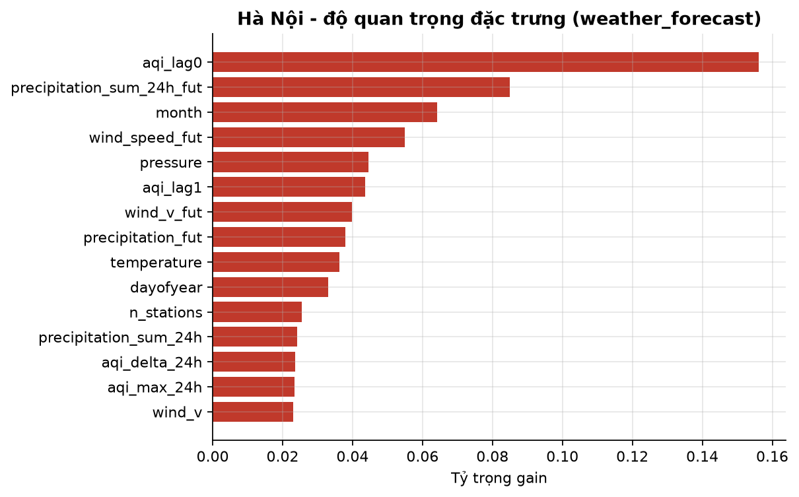

### 5.4. Triển khai

Mô hình tạo ra một giá trị AQI dự báo liên tục; nó không trực tiếp phát cảnh báo. Luồng triển khai là:

```text
daily_agg (AQI đo gần nhất) ─┐
                            ├─► tạo đặc trưng ─► XGBoost ─► forecasts ─► Grafana
Open-Meteo Forecast API ────┘
```

Script `ml/serving/predict.py` chạy mỗi giờ. Với mỗi thành phố, script:

1. đọc 72 giờ AQI gần nhất từ Cassandra (`daily_agg`), bỏ giờ hiện tại vì chưa đủ số liệu;
2. lấy thời tiết theo giờ của 72 giờ qua và 24 giờ tới từ Open-Meteo Forecast API;
3. dự báo AQI sau 24 giờ và ghi vào bảng `forecasts`. Dashboard Grafana đọc bảng này để vẽ biểu đồ "dự báo so với thực tế".

Thời tiết lấy từ API thay vì chỉ dùng `weather_hourly`, vì mô hình `weather_forecast` cần biết thời tiết 24 giờ tới. Ngoài ra, số liệu thời tiết real-time trong Cassandra là ảnh chụp tức thời, ví dụ lượng mưa trong 15 phút gần nhất, khác nghĩa với số liệu tổng hợp theo giờ dùng khi huấn luyện. Nếu API lỗi, script tự chuyển sang mô hình `base`. Thành phố nào không có AQI đo trong 3 giờ gần nhất sẽ bị bỏ qua thay vì dự báo trên dữ liệu cũ.

Dự báo của tập test cũng được ghi vào `forecasts` để dashboard có lịch sử so sánh, với `model_name` có hậu tố `_backtest` để phân biệt với dự báo thật.

Nếu sau này muốn tạo cảnh báo sớm, hệ thống nên lưu riêng cảnh báo dự báo hoặc thêm `forecast_level`; không nên trộn với bảng `alerts` hiện tại. `alerts` biểu diễn điều đã được trạm đo ghi nhận, còn cảnh báo dự báo luôn có độ bất định.

## 6. Ý nghĩa thực tế, hạn chế và hướng cải thiện

**Mô hình đã đủ dùng cho cảnh báo sớm chưa?**

- **Để tham khảo mức AQI ngày mai:** dùng được. Sai số trung bình khoảng 25 đơn vị AQI, nhỏ hơn độ rộng một hạng AQI (50 đơn vị), và tốt hơn cách dự báo "ngày mai giống hôm nay". Tuy nhiên một dự báo nằm gần ranh giới giữa hai hạng AQI vẫn có thể bị phân loại sai.
- **Để tự động phát cảnh báo AQI > 150:** chưa đủ. Mô hình bỏ lỡ hơn 60% số giờ vượt ngưỡng ở Hà Nội và gần như không bắt được đỉnh ở TP.HCM. Trong bản hiện tại, cảnh báo phải tiếp tục dựa trên số đo thực tế; dự báo chỉ là thông tin hỗ trợ chuẩn bị trước.

**Hạn chế:**

1. **Dữ liệu train ngắn.** Hà Nội có khoảng 18 tháng; mùa đông 2024–2025 lại được dùng làm validation, nên tập train chỉ có trọn một đợt cao điểm (tháng 11–12/2024). TP.HCM có khoảng 7 tháng. Số liệu 2021–2023 không dùng được vì khác thiết bị (mục 1.2).
2. **Thời tiết ngày mai trong train là thời tiết đã xảy ra**, tức một bản dự báo hoàn hảo. Khi chạy thật, dự báo thời tiết có sai số, nên độ chính xác thực tế sẽ thấp hơn bảng ở mục 5.3. Mức chênh lệch có thể đo bằng cách so sánh dự báo real-time với số đo sau vài tuần vận hành.
3. **TP.HCM chỉ có một cảm biến giá rẻ.** Mức AQI tuyệt đối của TP.HCM chưa đáng tin bằng Hà Nội, và mọi khoảng mất tín hiệu của cảm biến đều làm thành phố không có số liệu.
4. **Số liệu năm 2026 chưa được dùng**, vì thời tiết lịch sử mới có đến hết 2025.

**Hướng cải thiện:**

1. Tải bổ sung thời tiết 2026 (01–10/2026) để có thêm khoảng 9 tháng dữ liệu train, gồm cả mùa đông 2025–2026.
2. Cải thiện khả năng bắt đỉnh ô nhiễm, theo một trong hai cách: dùng hàm mất mát chú trọng giá trị cao (hồi quy phân vị), hoặc huấn luyện riêng một mô hình phân loại "ngày mai có vượt 150 hay không" và chọn ngưỡng sao cho recall đủ cao.
3. Dùng số mô hình CAMS của các tỉnh lân cận phía đầu gió làm đặc trưng. Mục 4 cho thấy ô nhiễm mang tính vùng, nên AQI của các tỉnh lân cận có thể báo trước sự thay đổi ở Hà Nội.
4. So sánh với mô hình chuỗi thời gian học sâu (LSTM) khi có thêm dữ liệu. Với lượng dữ liệu hiện tại, XGBoost là lựa chọn hợp lý hơn.

## 7. Kết luận

Các kết quả chính của phần D có thể tóm tắt như sau:

1. Việc thay đổi mạng trạm tạo ra điểm gãy trong chuỗi AQI, nên chỉ dữ liệu từ mạng trạm hiện tại được dùng cho phân tích chính và huấn luyện.
2. Hà Nội ô nhiễm rõ nhất vào mùa đông; TP.HCM có AQI cao hơn trong mùa khô. Gió mạnh liên hệ với AQI thấp ở cả hai thành phố, còn mưa có tác động rõ nhất tại Hà Nội.
3. CAMS hữu ích để đối chiếu và so sánh vùng nhưng chưa đủ khớp với số đo để thay thế hoặc lấp chỗ trống cho quan trắc.
4. XGBoost có dự báo thời tiết ngày mai tốt hơn persistence về MAE ở cả hai thành phố. Mô hình Hà Nội đáng tin cậy hơn mô hình TP.HCM.
5. Mô hình hiện phù hợp để hiển thị dự báo AQI trước 24 giờ, nhưng chưa đủ recall để tự động phát cảnh báo ô nhiễm cao. Bảng `alerts` phải tiếp tục dựa trên số đo thực tế; bảng `forecasts` cung cấp thông tin dự báo để người dùng tham khảo.
